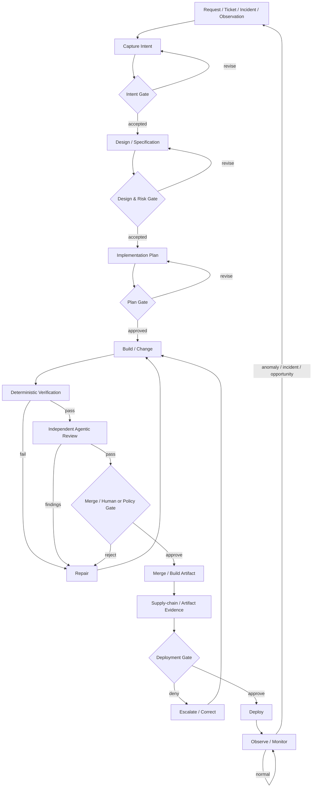

# Graph Engineering for an AI-Native SDLC
## Reference Architecture, Control Model, and Codebase Assessment Standard

**Version:** 1.0  
**Research date:** 2026-09-17  
**Purpose:** Define a framework-neutral target architecture for applying graph-engineering principles to the software development lifecycle (SDLC), suitable as the source of truth for a later codebase/repository architecture assessment.

---

## 0. How to use this document

This document is intentionally split from the repository-assessment prompt.

- **This document defines the target state:** what capabilities a robust graph-engineered, AI-assisted SDLC should have and why.
- **The companion prompt defines the assessment procedure:** how an agent should inspect a real repository, collect evidence, compare current state to this target, and propose a migration plan.
- Vendor-specific products and file names are examples, **not requirements**, unless the repository being assessed already uses that product.
- The assessment should prefer existing project/platform mechanisms over adding a new framework solely to match examples in this report.

### Normative language

Within the **Target Architecture** sections:

- **MUST** = required for the capability to be considered structurally sound in a production-grade implementation.
- **SHOULD** = strongly recommended; omission requires a concrete justification.
- **MAY** = context-dependent optimization.
- These terms express **this report's synthesized target architecture**. They are not claims that NIST, Anthropic, LangChain, GitHub, or another source uses the same normative wording unless explicitly stated.

---

# 1. Research question

The practical question is not:

> “How do we add a graph framework to our SDLC?”

It is:

> **How should an AI-assisted software-delivery system represent work, state, evidence, routing, authority, verification, recovery, and feedback so that agents can perform substantial work while the lifecycle remains predictable, auditable, secure, resumable, and governable?**

That distinction matters. “Graph Engineering” is an emerging architectural label, not a recognized SDLC standard. LangChain explicitly describes the term as new/buzzy while arguing that the underlying idea—representing agentic systems as graphs/state machines—is well established [S1].

Therefore, this report does **not** treat “Graph Engineering” as a compliance framework. It synthesizes a target architecture from:

1. primary guidance on graph-based agent systems;
2. primary guidance on AI-native/agentic SDLCs;
3. secure-SDLC standards/guidance;
4. official controls for source, CI/CD, approvals, and deployment;
5. official guidance for agent permissions, persistence, tool access, and observability.

---

# 2. Source policy and evidence hierarchy

Only primary, official, or standards-body sources are used as normative evidence in this report.

## 2.1 Evidence classes

### A. Standards / neutral security frameworks
Highest weight for security and software-supply-chain requirements.

- NIST SP 800-218 SSDF v1.1 [S8]
- NIST SP 800-218A [S9]
- SLSA / OpenSSF [S10]
- Model Context Protocol security guidance [S15]
- OpenTelemetry semantic conventions / official guidance [S16]

### B. First-party platform/documentation evidence
Highest weight for how a specific control actually behaves.

- LangGraph official documentation [S2–S4]
- Claude Code official documentation [S6–S7]
- GitHub official documentation [S11–S12]

### C. First-party practitioner architecture guidance
Strong evidence for patterns, but not standards.

- LangChain “3 Years of Graph Engineering with LangGraph” [S1]
- Anthropic “Building effective agents” [S5]
- Anthropic “The AI-Native SDLC playbook” [S13]
- Anthropic “How Anthropic secures its AI-native software development lifecycle” [S14]

## 2.2 Explicit exclusions

The research phase found third-party repositories/articles that use terms such as “Graph Engineering,” “AI-native SDLC,” or “agent graphs.” They were **not** used as normative sources because the user requested official/reliable sources only.

---

# 3. What “Graph Engineering” means here

LangChain's first-party definition is the best direct grounding for the term: a graph gives a concrete workflow; **nodes perform work**, **edges define what happens next**, and **state moves through transitions**. They describe it as state-machine-like and emphasize that real production agent graphs commonly require cycles, retries, dynamic routing, and human pauses rather than being simple DAGs [S1].

For this report:

> **Graph Engineering for the SDLC is the explicit design of software-delivery work as a governed stateful graph whose nodes perform bounded work, whose edges encode legal transitions, whose state and artifacts persist across runs, and whose gates enforce verification and authority boundaries.**

A graph-engineered SDLC is therefore more than a diagram. To count as an engineered execution model, the graph needs:

- explicit node responsibilities;
- explicit state;
- explicit transition rules;
- durable artifacts/evidence;
- bounded retries and recovery behavior;
- authority/permission boundaries;
- verification gates;
- human escalation/approval where risk requires it;
- observability of the run;
- a feedback path from production back into planning.

---

# 4. What it is **not**

## 4.1 Not “use LangGraph everywhere”
LangChain itself warns that some tasks are too open-ended to benefit from a heavily predetermined graph. An agent harness may be better for work whose internal planning/delegation cannot be usefully specified ahead of time [S1].

## 4.2 Not “replace the SDLC with autonomous agents”
Anthropic's AI-native SDLC keeps recognizable lifecycle responsibilities—plan, design, build, test, deploy, maintain—while changing handoffs, automation, artifact flow, and where humans spend attention [S13].

## 4.3 Not “put all company rules in a prompt”
Claude Code documentation explicitly distinguishes persistent behavioral instructions from technical enforcement. A `CLAUDE.md` shapes behavior; it does not guarantee enforcement. Hard restrictions require mechanisms such as permissions, sandboxing, hooks, CI checks, or infrastructure controls [S6][S7].

## 4.4 Not “one super-agent”
Anthropic's security practice uses narrow, specialized reviewing agents and hard identity boundaries rather than assuming a single broad agent can safely author, evaluate, approve, and deploy its own work [S14].

## 4.5 Not a conventional DAG-only pipeline
Agentic execution requires repair loops, clarification loops, retry paths, approval pauses, and production feedback. LangChain explicitly notes production agent graphs are generally not DAGs [S1].

---

# 5. Architectural principle: put determinism around nondeterminism

The most important synthesis across the sources is:

> **Use models where judgment adds value; use deterministic mechanisms for authority, invariants, state transitions, and evidence whenever those can be expressed mechanically.**

Evidence:

- LangChain: graphs let the system encode valid paths and decide where the model chooses versus where software enforces behavior [S1].
- Anthropic: predefined workflows are preferred for predictable tasks; agents are appropriate when flexibility is required; use the simplest adequate architecture [S5].
- Anthropic's SDLC/security guidance: combine deterministic checks with agentic review, preserve human accountability for high-risk decisions, and enforce hard boundaries in infrastructure rather than trusting instructions [S13][S14].
- GitHub: protected branches and deployment environments can make reviews, status checks, and deployment approvals executable requirements [S11][S12].

This yields three execution classes:

| Class | Best for | Examples |
|---|---|---|
| **Deterministic node/control** | Invariants, policy, routing that can be encoded exactly | tests, lint, schema validation, permission checks, branch rules, artifact signatures |
| **Model/agent node** | Contextual judgment, synthesis, diagnosis, implementation | design analysis, coding, semantic review, incident triage |
| **Human gate** | Accountability, risk acceptance, ambiguous intent, irreversible/high-impact action | spec approval, security exception, production authorization |

A robust graph intentionally mixes all three.

---

# 6. Target-state lifecycle graph

The exact stages can vary by organization. The following is a framework-neutral reference model derived primarily from Anthropic's six-stage AI-native SDLC loop [S13], enriched with graph execution, verification, security, and recovery controls from the other sources.



## 6.1 What makes this a graph instead of a checklist

The graph has:

- **cycles:** verification → repair → build, review → repair, production → intent;
- **conditional edges:** risk tier, test outcome, review outcome;
- **interruptible gates:** waiting for human input without losing state;
- **fan-out/fan-in:** independent implementation/review tasks can execute concurrently and join before a gate;
- **persistent state:** a run can stop and resume without reconstructing its history from chat;
- **evidence-carrying transitions:** a transition should happen because a machine/verifier/authorized approver produced the required evidence, not because an agent said “done.”

---

# 7. Control plane vs. work plane

A useful architecture separates the **control plane** from the **work plane**.

## 7.1 Control plane

The control plane decides:

- which node may execute;
- which actor/agent identity is assigned;
- which tools and permissions it receives;
- what inputs/artifacts are authoritative;
- what validator is required;
- what outcome routes to which edge;
- when retries stop;
- when a human is required;
- when an operation is prohibited;
- what evidence must be persisted.

The control plane SHOULD be as deterministic as practical.

## 7.2 Work plane

The work plane performs the actual task:

- analyze requirements;
- inspect code;
- design;
- implement;
- write tests;
- review semantically;
- diagnose a failure;
- prepare a release;
- investigate an incident.

The work plane MAY contain LLM calls or autonomous agents.

## 7.3 Why the distinction matters

If an agent both performs work and has unrestricted control over the conditions that declare its work valid, the system effectively lets the worker rewrite its own exam.

Anthropic's SDLC guidance explicitly preserves separation of duties in review: the code-writing agent is not the approving authority, and branch protection/human approval supplies the gate [S13]. Anthropic's security practice similarly uses separate identities and reviewers with constrained permissions [S14].

**Target requirement:** authoring capability and approval authority MUST be independently enforceable.

---

# 8. Core graph contracts

A graph becomes reviewable only when its parts have explicit contracts.

## 8.1 Node contract

Every material node SHOULD define:

```yaml
node:
  id: stable-identifier
  purpose: one bounded responsibility
  input_contract:
    required_artifacts: []
    state_fields: []
    preconditions: []
  executor:
    type: deterministic | model | agent | human | composite
    identity: role-or-service-principal
    tool_allowlist: []
    permission_scope: []
  output_contract:
    artifacts: []
    structured_result_schema: {}
    evidence: []
  verification:
    deterministic_checks: []
    evaluator: optional-independent-evaluator
  execution:
    timeout: bounded
    retry_policy: bounded
    idempotency_strategy: required-for-side-effects
  transitions:
    success: next-node
    failure: repair-or-escalate
    needs_input: human-or-context-node
  telemetry:
    required_events: []
```

The schema itself is illustrative. The **capabilities** are the target.

### Required characteristics

A production-relevant node MUST have:

1. one intelligible responsibility;
2. declared inputs/preconditions;
3. declared outputs;
4. constrained authority;
5. a success criterion external to free-form self-report where practical;
6. explicit failure routing;
7. bounded retry behavior;
8. durable evidence for consequential work.

## 8.2 Edge contract

An edge is an allowed transition, not merely an arrow.

```yaml
edge:
  from: build
  to: verify
  trigger: change-artifact-created
  guard:
    - artifact-schema-valid
    - run-not-cancelled
  carries:
    - change_ref
    - intent_ref
    - plan_ref
  on_guard_failure: blocked
  audit_event: transition.build_to_verify
```

An edge SHOULD specify:

- source and destination;
- trigger;
- guard condition;
- state/artifact payload;
- authority required to traverse it;
- behavior when guard evaluation fails;
- emitted audit event.

## 8.3 Gate contract

A gate is a decision boundary.

```yaml
gate:
  id: production-release
  risk_tiers: [high, critical]
  required_evidence:
    - required-ci-checks
    - review-approval
    - deployment-artifact-ref
  approver:
    role: release-manager
    self_approval: forbidden
  outcomes:
    approve: deploy
    reject: repair
    expire: blocked
```

A gate MUST NOT be represented solely by “ask the model whether it is safe.”

## 8.4 Artifact contract

Artifacts carry truth between nodes and sessions.

A material artifact SHOULD have:

- stable type and schema/version;
- canonical source-of-truth location;
- producer identity;
- creation timestamp;
- linkage to run/work item;
- linkage to source revision/commit where applicable;
- review/approval state where applicable;
- immutable or append-only evidence for critical decisions.

Examples:

- intent/spec/plan;
- code diff / commit / PR;
- test results;
- evaluation results;
- review findings;
- approval event;
- build provenance;
- deployment record;
- incident/postmortem;
- rollback evidence.

Anthropic's AI-native SDLC uses committed artifacts to connect stages and make the chain itself an audit trail [S13].

---

# 9. Durable state and resumability

A session transcript is not a workflow database.

LangGraph's official persistence design illustrates the required distinction: checkpoints persist thread/graph state for continuation and fault tolerance, while stores handle data meant to outlive a single thread [S3]. Its interrupt model persists graph state before waiting for human/external input [S4].

## 9.1 Target requirements

A production workflow that can outlive a single process/session MUST persist at least:

- `run_id`;
- graph/workflow definition version;
- current node(s);
- input artifact references;
- output artifact references;
- completed-node outcomes;
- pending gates;
- retry counters;
- actor identities;
- timestamps;
- cancellation state;
- failure/escalation state.

It SHOULD additionally persist:

- model/config version used by agentic nodes;
- policy/instruction version;
- tool call summaries;
- evaluator results;
- cost/token metrics if relevant;
- parent/child run relationships.

## 9.2 Resume semantics

The system MUST define what happens after:

- process crash;
- network failure;
- agent timeout;
- CI worker replacement;
- human approval arriving hours/days later;
- duplicate webhook/event;
- partial node completion.

## 9.3 Idempotency

A resumable graph can re-execute work. Therefore, side-effecting nodes MUST be designed for idempotency or protected by deduplication/transactional semantics.

Examples:

- creating a PR should not create ten duplicate PRs after retries;
- posting a review comment should carry a stable event/idempotency key;
- deployment should be keyed to a specific immutable artifact;
- “send notification” should be deduplicated if the node resumes.

A repository assessment should treat “retry exists” without an idempotency story as a defect, not a reliability feature.

---

# 10. Artifact-driven handoffs

Anthropic's AI-native SDLC explicitly describes stages ending in committed artifacts that the next stage consumes [S13].

The generalizable principle is:

> **Do not make ephemeral conversation state the only interface between lifecycle stages.**

## 10.1 Target requirements

For each material handoff:

- the producer MUST emit a persistent artifact or structured state;
- the consumer MUST be able to identify the exact artifact/version used;
- the transition SHOULD be triggerable from artifact acceptance rather than manual re-prompting;
- the artifact SHOULD be human-readable when human judgment is expected;
- the artifact SHOULD be machine-readable enough for validation and routing.

## 10.2 Source of truth

For every artifact category, declare one authoritative source or a precise synchronization/linkage rule.

Do not let the same “spec” silently diverge across:

- Jira ticket;
- Markdown file;
- PR description;
- chat transcript;
- generated plan;
- wiki page.

If legacy and repo-native systems coexist, link identifiers and revisions explicitly.

---

# 11. Context architecture: durable knowledge, not context-window accumulation

AI agents need durable organizational/project context, but blindly increasing context is not architecture.

Claude Code's docs describe project instructions as persistent context loaded across sessions, while emphasizing that instructions are behavioral guidance, not hard enforcement [S6]. Anthropic's SDLC playbook recommends version-controlled project context and reusable skills/policies [S13].

## 11.1 Context layers

A useful target model separates:

1. **Global governance context**  
   Organizational security/compliance policy.

2. **Repository architecture context**  
   Project layout, invariants, supported commands, major architectural constraints.

3. **Path/domain-scoped context**  
   Rules relevant only to a subsystem.

4. **Task artifacts**  
   Intent, spec, plan, acceptance criteria.

5. **Retrieved operational context**  
   Previous incidents, design decisions, service ownership, runtime evidence.

6. **Ephemeral execution context**  
   Current agent conversation/reasoning.

## 11.2 Behavioral guidance vs. enforcement

This separation is mandatory in the assessment:

| Requirement type | Appropriate mechanism |
|---|---|
| “Prefer this naming convention” | instruction/context |
| “Use this architectural boundary” | instruction + architecture tests where feasible |
| “Never expose production secret X” | permission/secret boundary |
| “Never push directly to main” | branch/repository enforcement |
| “Production needs approval” | deployment protection / authorization gate |
| “Tests must pass” | CI required check |
| “Agent may only use these tools” | runtime permission/tool allowlist |
| “Do not edit protected file during repair” | file/tool guard, hook, sandbox policy |

**A prompt is not a security boundary.**

---

# 12. Verification architecture

AI-native delivery increases code-generation capacity. Verification must scale with it.

## 12.1 Layered verification

The target architecture SHOULD combine:

### Layer A — deterministic verification
Examples:

- compile/typecheck;
- unit/integration/e2e tests;
- lint/format policy;
- schema validation;
- dependency policy;
- SAST;
- secret scanning;
- invariant tests;
- infrastructure policy checks.

### Layer B — model-based semantic verification
Examples:

- spec compliance;
- architectural consistency;
- cross-component logic;
- security reasoning that requires context;
- migration completeness;
- review of assumptions and edge cases.

### Layer C — independent approval/risk acceptance
Examples:

- code owner;
- security owner for high-risk changes;
- release manager;
- service owner.

Anthropic describes combining deterministic and agentic reviews and retaining humans at risk-sensitive points [S14].

## 12.2 Evaluator independence

Where an evaluator can block/approve consequential work, it SHOULD have independence from the authoring execution:

- fresh context where feasible;
- separate role/prompt;
- narrower permissions;
- no ability to silently edit the evidence it is evaluating;
- no direct approval authority if policy reserves approval for a human/system gate.

## 12.3 Verification evidence

“Tests passed” is insufficient if the only evidence is the author's narrative.

Prefer evidence generated by the toolchain:

- command exit status;
- CI check run;
- test report;
- coverage/invariant result;
- signed/attested artifact metadata;
- structured evaluator output with trace;
- PR review state.

---

# 13. Continuous evaluations for agent configuration

Agent behavior can change even when product code does not.

Changes to:

- model selection;
- prompts;
- project instructions;
- skills/rules;
- tool descriptions;
- hooks;
- routing logic;
- retrieval context;
- agent permissions

can alter outcomes.

Anthropic's playbook recommends continuous evals for agent configuration, including running evaluations when agent configuration changes and turning production incidents into regression cases [S13].

## 13.1 Target requirements

If agent behavior affects production code or approvals:

- agent configuration SHOULD be version-controlled;
- meaningful configuration changes SHOULD receive review;
- representative evaluation cases SHOULD exist;
- evaluation results SHOULD be persisted;
- regressions SHOULD block or escalate changes according to risk;
- production failures SHOULD feed new regression cases where applicable.

## 13.2 What to evaluate

A good eval suite should test behavior, not merely whether the model returns parseable text.

Examples:

- follows repository architecture rules;
- does not weaken tests to make a bug fix pass;
- uses required validation commands;
- respects tool/permission constraints;
- produces correctly structured artifacts;
- routes high-risk changes to human approval;
- identifies known incident classes;
- does not claim success when required evidence is absent.

---

# 14. Human-in-the-loop as an explicit graph primitive

Human involvement should be designed, not improvised.

LangGraph's interrupt mechanism illustrates a core pattern: pause execution, persist state, surface a decision request, then resume the same run after input [S4].

## 14.1 Human gates are appropriate when

- intent is ambiguous;
- risk acceptance is required;
- a policy exception is requested;
- a destructive/irreversible action is pending;
- production deployment requires authorization;
- legal/regulatory accountability requires a person;
- confidence/evidence is below the automation threshold.

## 14.2 Gate UX requirements

A reviewer SHOULD receive:

- decision requested;
- concise artifact summary;
- risk tier;
- required evidence;
- relevant diffs/findings;
- what will happen on approve/reject;
- identity of the requesting agent/run.

A human gate that requires the reviewer to reconstruct the entire history manually is technically present but operationally poor.

---

# 15. Risk-tiered autonomy

Not every file, service, or action deserves the same autonomy.

Anthropic describes tiering code by risk and varying automation/review accordingly [S14].

## 15.1 Example policy

| Risk | Example | Agent authority |
|---|---|---|
| Low | docs, formatting, generated metadata | may auto-fix and open PR; deterministic gates |
| Medium | routine application logic | may implement + self-verify; independent review + standard human merge policy |
| High | auth, payments, PII, security-sensitive infra | specialized reviews + mandatory human owner approval |
| Critical | production IAM, irreversible data changes, release authority | highly constrained agent tools; explicit named human gate; no self-approval |

This is an example model, not a universal classification.

## 15.2 Risk must change execution

A risk label is useless unless it affects:

- available tools;
- permission scope;
- reviewers;
- required evidence;
- deployment path;
- retry/escalation policy;
- logging/audit retention.

---

# 16. Identity, permissions, and “least agency”

Anthropic's security guidance emphasizes hard access/identity boundaries, single-purpose identities, minimum permissions, and drawing boundaries around **actions/access**, not around what instructions supposedly tell the model to do [S14].

The MCP security guidance likewise treats authorization, scope minimization, token handling, and auditability as protocol-level security concerns [S15].

## 16.1 Target requirements

Every agent/service that can produce side effects MUST have an attributable identity.

Permissions SHOULD be scoped by:

- repository;
- path if practical;
- tool;
- API action;
- environment;
- credential;
- time/duration;
- risk tier.

Agent jobs SHOULD NOT receive production credentials by default.

## 16.2 Tool boundary

A tool contract SHOULD expose the narrow business operation required rather than a general shell with broad credentials when feasible.

Prefer:

- `deploy(environment, artifact_id)`
- `rollback(environment, release_id)`
- `get_status(service)`

over:

- unrestricted shell + production token.

## 16.3 Agent-to-agent authority

Agent-to-agent communication must not become an authority-bypass path.

If Agent A cannot deploy but can instruct Agent B, and Agent B can deploy without an independent gate, Agent A effectively has indirect deployment authority.

Assessment must therefore inspect **transitive capability**, not just direct permission.

---

# 17. Source control and merge enforcement

GitHub's official branch protection provides an example of hard repository-level enforcement: required reviews, required status checks, code-owner approval, restriction on direct push, and prevention of bypass [S11].

The framework-neutral target is:

- agent-authored changes MUST land through a reviewable change mechanism;
- required validation MUST be enforced outside the authoring agent;
- protected branches SHOULD prevent direct agent writes;
- high-risk repositories SHOULD prohibit bypass for ordinary automation identities;
- approval SHOULD come from an independent actor according to policy.

If the project uses GitLab/Bitbucket/Azure DevOps/etc., equivalent native controls satisfy the requirement.

---

# 18. Deployment gate and environment separation

GitHub Environments illustrate an enforceable production boundary: environment protection rules can require approval before a job runs or receives environment secrets, and can prevent self-review [S12].

## 18.1 Target requirements

Production deployment SHOULD be tied to:

- immutable release/build artifact;
- required verification evidence;
- authorized deployment identity;
- environment-specific permission;
- explicit policy/human gate according to risk;
- logged deployment event;
- tested rollback path.

The agent that authors a change SHOULD NOT automatically gain permission to approve and deploy that change merely because it authored it.

---

# 19. Software supply-chain integrity

Graph engineering does not replace secure software supply-chain controls.

NIST SSDF is intentionally designed to integrate secure development practices into any SDLC [S8]. SLSA provides a framework for artifact integrity and resistance to tampering across the software supply chain [S10].

## 19.1 Target capability

The assessment SHOULD determine whether the system can answer:

- What source revision produced this artifact?
- What build process produced it?
- Which checks were run?
- Can the artifact be substituted after approval?
- Are dependencies/build inputs controlled?
- Is provenance/attestation available where risk justifies it?
- Can the deployment system verify that it is deploying the intended artifact?

For high-assurance environments, provenance SHOULD be machine-verifiable rather than inferred from naming conventions.

---

# 20. Orchestration patterns

Anthropic identifies several composable workflow patterns [S5]. Graph engineering provides a useful way to combine them.

## 20.1 Prompt/work chaining

Use when work decomposes into stable sequential steps.

SDLC example:

`spec -> plan -> implementation -> verification`

## 20.2 Routing

Use when categories need different policies or specialists.

Example:

`change -> classify risk -> standard path / security path / migration path`

## 20.3 Parallelization

Use when tasks are independent or multiple perspectives improve confidence.

Examples:

- parallel independent code changes in isolated worktrees;
- correctness/security/performance review agents;
- per-module migration work.

Parallelism requires a **join condition** before downstream gates.

## 20.4 Orchestrator-workers

Use when the exact subtasks are discovered at runtime.

Example:

- inspect migration scope;
- discover affected modules;
- dispatch bounded workers;
- aggregate results;
- run repository-wide verification.

## 20.5 Evaluator-optimizer / repair loop

Use when output can be evaluated and improved iteratively.

Example:

`implement -> tests/review -> repair -> tests/review`

Every cycle MUST have a termination/escalation policy.

---

# 21. Parallelism and isolation

Parallel agents increase throughput but also conflict risk.

## 21.1 Target requirements

Concurrent workers SHOULD have:

- disjoint or explicitly coordinated scopes;
- isolated workspaces/worktrees where code changes overlap;
- bounded tool permissions;
- stable task contracts;
- independent output artifacts;
- a deterministic integration/join step;
- repository-wide verification after integration.

Do not equate “spawn more agents” with scalability.

The orchestration layer must own:

- dependency ordering;
- concurrency limit;
- conflict detection;
- cancellation;
- aggregation;
- final verification.

---

# 22. Retry, repair, failure, and termination policy

Unbounded loops are an architectural defect.

## 22.1 Every cycle SHOULD declare

- retryable failures;
- maximum attempts or budget;
- backoff where relevant;
- what new information must change between attempts;
- whether a different evaluator/model/worker is used;
- terminal failure state;
- human escalation condition.

## 22.2 Failure classes

Distinguish at least:

1. **Transient infrastructure failure**  
   Retry may be appropriate.

2. **Tool/permission failure**  
   Often needs permission correction or escalation, not blind retry.

3. **Validation failure**  
   Route to repair with evidence.

4. **Ambiguous requirement**  
   Route to human/intent clarification.

5. **Policy denial**  
   Terminal unless an authorized exception process exists.

6. **Repeated model failure**  
   Escalate; do not burn unbounded tokens in the same loop.

---

# 23. Observability and auditability

A graph-engineered SDLC should be observable as a distributed execution system.

Anthropic reports logging agent approvals, tool calls, and agent-to-agent messages for attribution/audit [S14]. OpenTelemetry's GenAI guidance standardizes telemetry for model calls/tool activity and is useful as a vendor-neutral observability substrate [S16].

## 23.1 Minimum run telemetry

For each run:

- run/workflow ID;
- graph version;
- node start/end;
- node result;
- actor/agent identity;
- transition taken;
- retry count;
- gate request and decision;
- artifact references;
- failure/exception;
- timing.

For model nodes, SHOULD include where permitted:

- model/provider identifier;
- token/cost metrics;
- tool calls;
- evaluator result;
- configuration/prompt version.

## 23.2 Security and privacy

Full prompt/tool content can contain:

- secrets;
- source code;
- customer data;
- credentials;
- sensitive operational context.

Telemetry collection therefore MUST have:

- data classification;
- redaction policy;
- retention policy;
- access controls;
- explicit decision about whether content is recorded.

Observability must not become a new exfiltration channel.

---

# 24. Closed-loop maintenance

Anthropic's AI-native SDLC explicitly makes maintenance feed production evidence back into new intent [S13].

This is one of the strongest reasons to model the lifecycle as a graph rather than a line.

## 24.1 Target loop

`production signal -> deterministic trigger/classifier -> diagnosis -> evidence -> new intent/work item -> normal design/build/test/review/deploy graph`

The monitoring agent SHOULD NOT get a secret “fast lane” around normal release controls.

## 24.2 Production incident feedback

Where applicable, an incident SHOULD update:

- regression tests;
- agent eval suite;
- security/architecture guidance;
- runbook;
- policy;
- detection/control bands.

A closed loop changes the system so the same class of failure becomes harder to repeat.

---

# 25. Policy and instruction lifecycle

Agent instructions are executable organizational knowledge and should be treated with software-engineering discipline.

## 25.1 Target requirements

Material agent configuration SHOULD be:

- version-controlled;
- owned;
- reviewed;
- scoped;
- tested/evaluated;
- observable in runs;
- linked to incidents that motivated changes;
- retired when stale.

## 25.2 Policy hierarchy

Prefer:

1. **hard infrastructure policy** for non-negotiable restrictions;
2. **deterministic tests/checks** for machine-verifiable rules;
3. **agent instructions/skills** for contextual judgment and conventions;
4. **human judgment** for exceptions and ambiguous risk.

Do not invert this hierarchy by expressing a hard security property only as natural-language guidance.

---

# 26. Security baseline mapping

Graph engineering should sit **inside** a secure SDLC, not beside it.

## 26.1 NIST SSDF mapping

NIST SP 800-218 groups secure software development around preparation, protecting software, producing well-secured software, and responding to vulnerabilities [S8].

A graph-engineered implementation should make these responsibilities visible in nodes/controls:

| SSDF concern | Graph-engineered implementation examples |
|---|---|
| Prepare organization | policy ownership, role/identity model, approved toolchain, risk classification |
| Protect software | repository protections, secrets boundaries, artifact integrity |
| Produce well-secured software | design review, code review, tests, SAST, agentic security review |
| Respond to vulnerabilities | monitoring, incident node, remediation graph, regression/eval feedback |

NIST SP 800-218A adds AI-specific secure-development considerations for organizations producing AI systems/models [S9]. It is relevant when the software being developed is itself an AI system, but it should not be misrepresented as a standard specifically for coding-agent orchestration.

---

# 27. Graph definition versioning and change control

The workflow itself is production logic.

A graph change can alter:

- who may approve;
- which validation can be skipped;
- which tool an agent can call;
- whether a deployment can occur;
- how failures route;
- what data is persisted.

Therefore:

- graph definitions SHOULD be version-controlled;
- run records MUST identify the graph version used;
- changes to gates/permissions SHOULD receive heightened review;
- graph changes SHOULD be tested using representative scenarios;
- old in-flight runs need a declared migration/compatibility policy.

---

# 28. Minimal viable graph vs. overengineering

Anthropic's agent guidance recommends the simplest solution that meets the task [S5], and LangChain notes that not every open-ended task should be hard-coded as a graph [S1].

Use explicit graph orchestration when one or more of these become material:

- multiple distinct responsibilities;
- different permission domains;
- durable execution across sessions;
- conditional routing;
- human pauses;
- parallel workers;
- independent verification;
- retries/repair loops;
- audit requirements;
- production feedback;
- meaningful failure/recovery semantics.

A one-step code-edit task does not need a ten-node agent organization.

---

# 29. Reference capability model

The downstream codebase assessment should evaluate the following capabilities, not vendor names.

## GE-01 — Explicit workflow topology
**MUST:** Material lifecycle paths, gates, repair loops, and terminal states are identifiable.

Evidence examples:
- workflow code/config;
- CI definitions;
- orchestration definitions;
- documented state machine.

Failure smell:
- one long prompt/script controls everything with implicit transitions.

## GE-02 — Typed/bounded node responsibilities
**MUST:** Material steps have bounded responsibilities, inputs, outputs, and failure behavior.

Failure smell:
- “super-agent handles the entire SDLC.”

## GE-03 — Explicit transition/guard logic
**MUST:** Consequential transitions depend on explicit conditions/evidence.

Failure smell:
- next stage starts because an agent's prose says “ready.”

## GE-04 — Durable workflow state
**MUST when runs outlive a process/session:** State can survive interruption/failure and resume.

Failure smell:
- only chat history indicates progress.

## GE-05 — Idempotent/recoverable side effects
**MUST:** Retry/resume cannot silently duplicate consequential actions.

Failure smell:
- rerunning node can deploy/post/create repeatedly without deduplication.

## GE-06 — Persistent artifact chain and lineage
**MUST:** Material stage outputs are persistent and linkable to the work/run.

Failure smell:
- accepted requirements/plan exist only in conversation.

## GE-07 — Canonical source-of-truth policy
**SHOULD:** Each artifact category has an owner/source or explicit synchronization rule.

Failure smell:
- ticket/spec/PR disagree with no canonical version.

## GE-08 — Behavioral context separated from hard policy
**MUST:** Non-negotiable restrictions are enforced outside model instructions.

Failure smell:
- “do not deploy to prod” appears only in a prompt.

## GE-09 — Least-privilege agent identity
**MUST for side effects:** Actions are attributable to constrained identities.

Failure smell:
- shared developer/admin token for all agents.

## GE-10 — Tool/action allowlisting
**SHOULD:** Agents receive only tools/actions required by the node.

Failure smell:
- unrestricted shell/cloud credentials for read-only analysis.

## GE-11 — Independent verification
**MUST:** Authoring output is verified by deterministic and/or independent mechanisms appropriate to risk.

Failure smell:
- authoring agent declares its own success with no external evidence.

## GE-12 — Required deterministic checks
**MUST:** Machine-verifiable invariants use machine checks.

Failure smell:
- model reviews formatting/type errors that CI could deterministically reject.

## GE-13 — Human/risk gate
**MUST where organizational risk requires it:** Approval is explicit, attributable, resumable, and cannot be silently skipped.

Failure smell:
- “human in the loop” means a Slack message with no connection to execution state.

## GE-14 — Separation of duties
**MUST for consequential approval:** Authoring identity cannot unilaterally approve its own production path.

Failure smell:
- same agent token writes, approves, merges, and deploys.

## GE-15 — Protected integration path
**SHOULD/MUST for production repos:** Direct writes to protected branches are blocked; required checks/reviews are enforced.

Failure smell:
- policy exists only in README.

## GE-16 — Environment-specific deployment boundary
**MUST for production:** Production secrets/authority are gated separately from build authority.

Failure smell:
- coding worker carries production credentials.

## GE-17 — Supply-chain evidence
**SHOULD according to risk:** Release artifact is traceable to source/build and protected from substitution.

Failure smell:
- deploy script selects “latest.zip” with no provenance.

## GE-18 — Bounded retries and loop termination
**MUST:** Every repair/retry loop has an exit/escalation rule.

Failure smell:
- `while not success: ask_agent_again()`.

## GE-19 — Parallelism safety
**MUST if parallel agents write:** Isolation, dependency ordering, join/integration, and final validation exist.

Failure smell:
- multiple agents modify same workspace/branch without coordination.

## GE-20 — Agent-config versioning
**SHOULD:** Prompts/rules/skills/hooks/routing that materially affect behavior are versioned and reviewable.

Failure smell:
- production agent prompt edited manually in UI with no history.

## GE-21 — Agent regression evaluation
**SHOULD; MUST for high-impact autonomous use:** Representative evals run on material configuration/model changes.

Failure smell:
- upgrade model/prompt and assume behavior is unchanged.

## GE-22 — Graph observability
**MUST for production automation:** Run/node/transition/gate/failure events are observable and attributable.

Failure smell:
- only final PR exists; no way to know how it was produced.

## GE-23 — Audit evidence
**MUST for consequential actions:** Who/what/when/why/evidence can be reconstructed.

Failure smell:
- shared bot identity and mutable logs.

## GE-24 — Production feedback loop
**SHOULD:** Incidents/findings can generate new structured work and regressions without bypassing normal controls.

Failure smell:
- postmortem action items never reach code/evals/policy.

## GE-25 — Security context and untrusted-input handling
**MUST for tool-using agents:** Prompt injection/untrusted content is assumed possible; network/tool/credential boundaries contain impact.

Failure smell:
- browsing/untrusted issue content + unrestricted credentials/network.

## GE-26 — Transitive authority analysis
**MUST for multi-agent systems:** An agent cannot bypass its own limits by instructing another more privileged agent.

Failure smell:
- read-only triage agent can message deploy agent that acts automatically.

## GE-27 — Cancellation/terminal states
**SHOULD:** Runs can be cancelled, superseded, failed, or completed unambiguously.

Failure smell:
- stale agent task resumes after change was abandoned.

## GE-28 — Rollback/recovery path
**MUST for production deployment:** Rollback or recovery is explicit and tested commensurate with risk.

Failure smell:
- deploy automation is sophisticated; rollback is a manual wiki page never exercised.

## GE-29 — Data/telemetry governance
**MUST:** Logs/traces do not indiscriminately capture secrets or sensitive content.

Failure smell:
- full prompts/tool results exported globally without redaction/retention controls.

## GE-30 — Architecture complexity justification
**MUST:** New graph/agent components solve an evidenced need.

Failure smell:
- framework migration proposed because “graph engineering” is fashionable.

---

# 30. Assessment status vocabulary

The repository-assessment agent should use:

- **SATISFIED** — evidence shows the target capability exists and is enforced appropriately.
- **PARTIAL** — some capability exists but important enforcement/coverage/reliability is missing.
- **MISSING** — no evidence of the required capability and it is applicable.
- **NOT_VERIFIABLE** — likely external to the repository or access is insufficient.
- **NOT_APPLICABLE** — capability does not apply; agent must explain why.

Do **not** treat “not found in repo” as automatically “missing” for SaaS controls such as branch protection or environment policy. Mark them `NOT_VERIFIABLE` and identify the evidence needed.

---

# 31. Priority model for remediation

Prioritize based on consequence and dependency, not fashion.

## P0 — Safety/control-plane blocker
Examples:

- agent can bypass production approval;
- shared broad production credentials;
- authoring agent can merge/deploy itself;
- no hard restriction around destructive actions;
- retry can duplicate destructive side effects.

## P1 — Foundational architecture gap
Examples:

- no durable state for long-running workflow;
- no artifact lineage;
- no external verification;
- no failure/termination model;
- no protected integration path.

## P2 — Reliability/governance improvement
Examples:

- missing agent eval regression suite;
- weak observability;
- manual handoffs that can be automated safely;
- insufficient context/version ownership.

## P3 — Optimization
Examples:

- better parallelism;
- cost/model routing;
- UX improvements for approval;
- richer metrics.

A remediation can be high priority even if it is small.

---

# 32. Suggested implementation layering

A project does not need to implement everything at once.

## Layer 1 — Make the current process explicit
- map current lifecycle;
- define authoritative artifacts;
- make existing CI checks mandatory;
- protect main/release branches;
- document production authority.

## Layer 2 — Make agent behavior reproducible
- version project instructions/policies;
- scope tools;
- use stable identities;
- persist agent/task configuration;
- attach verification evidence.

## Layer 3 — Make execution resumable
- explicit state model;
- durable run store/checkpoint;
- gate pause/resume;
- idempotency and retry policy.

## Layer 4 — Add independent evaluation
- specialized review;
- eval suite;
- risk routing;
- separation of duties.

## Layer 5 — Add graph automation
- artifact-triggered transitions;
- bounded repair loops;
- fan-out/fan-in;
- automated incident-to-intent loop.

## Layer 6 — Optimize and scale
- advanced observability;
- supply-chain attestations;
- dynamic worker orchestration;
- risk-based auto-approval where justified by evidence;
- continuous tuning.

This order is a synthesized recommendation, not a vendor-prescribed sequence.

---

# 33. Anti-pattern catalog

## AP-01 — Prompt-as-policy
A natural-language instruction is relied on to prevent an unsafe action.

**Fix:** move non-negotiable constraints into permissions/hooks/CI/platform policy.

## AP-02 — Ephemeral state
Workflow progress exists only in the current context window.

**Fix:** persist workflow state and artifacts.

## AP-03 — Self-certifying agent
The authoring agent is the only source of truth that work is correct.

**Fix:** deterministic evidence + independent evaluator/approval.

## AP-04 — Omnipotent service account
All agents share one broad credential.

**Fix:** single-purpose identities and least privilege.

## AP-05 — Unbounded repair loop
Agent retries until it says it is done.

**Fix:** attempt/budget limit, failure classes, escalation.

## AP-06 — Graph-shaped diagram, linear runtime
Documentation shows branches/cycles but implementation is still a sequential script with manual handoffs.

**Fix:** encode guards, state, retries, gates, and transitions in executable control logic.

## AP-07 — Hidden human gate
A human must approve in practice, but the workflow does not persist or enforce that decision.

**Fix:** explicit interrupt/gate state.

## AP-08 — Approval without evidence
Reviewer sees a summary but not test/build/review evidence.

**Fix:** gate payload includes machine evidence and relevant artifacts.

## AP-09 — Reviewer can mutate its own evidence
Evaluation agent edits code/tests while deciding whether they pass.

**Fix:** isolate reviewer or enforce read-only evaluation when possible.

## AP-10 — CI is advisory
Agent is told to run tests but merge does not require CI.

**Fix:** required status checks.

## AP-11 — Production credential leakage into build
General coding job receives deploy secrets.

**Fix:** environment-bound secrets and deployment identity.

## AP-12 — Parallel agents, shared mutable workspace
Workers overwrite/conflict without orchestration.

**Fix:** worktree/isolation + deterministic integration.

## AP-13 — No graph-version provenance
A run cannot identify the workflow/policy version that governed it.

**Fix:** persist graph/config version with run.

## AP-14 — Incident loop bypass
Production responder agent pushes a hotfix directly around standard gates.

**Fix:** diagnosis can be automated; code still re-enters controlled path.

## AP-15 — Framework-first migration
Team adds graph framework before identifying a control/reliability problem.

**Fix:** map requirements, reuse current CI/workflow platform, add runtime only where needed.

---

# 34. Framework mapping (examples, not requirements)

| Target capability | LangGraph example | Claude Code example | GitHub example | Generic alternative |
|---|---|---|---|---|
| workflow state | graph state/checkpointer | session/task artifacts | workflow state/artifacts | DB/workflow engine |
| human pause/resume | `interrupt()` + checkpoint | permission/hook interaction | environment approval | workflow task queue |
| hard tool control | node/tool design | permissions + hooks + sandbox | token/repo scope | policy engine |
| persistent context | store | `CLAUDE.md`, rules, skills | repo docs | `AGENTS.md`, policy files |
| merge gate | external | external | protected branch/ruleset | GitLab/Azure equivalent |
| deploy gate | external | hook/action boundary | environment protection | deployment platform |
| agent telemetry | LangSmith/OTel-compatible approaches | OTel export | Actions logs | OpenTelemetry |
| supply-chain integrity | external | external | artifact attestations possible | SLSA-compatible provenance |

No row implies that the named product is required.

---

# 35. Concrete design decisions the assessment must resolve

The downstream repository review should not stop at “capability present/absent.” It should resolve these architecture questions:

1. **Where does the canonical graph live?**
2. **What is the persisted run-state schema?**
3. **Which transitions are deterministic vs. agent-selected?**
4. **Which node types are pure/read-only vs. side-effecting?**
5. **What is the idempotency strategy?**
6. **What artifacts are canonical?**
7. **How is artifact lineage represented?**
8. **Where are hard guardrails enforced?**
9. **What are the agent identities and permission scopes?**
10. **Which actions are impossible for an authoring agent?**
11. **How is human approval persisted/resumed?**
12. **How are independent reviewers isolated?**
13. **What are loop budgets and escalation rules?**
14. **How is fan-out/fan-in handled?**
15. **How are conflicts integrated?**
16. **How is agent configuration versioned/evaluated?**
17. **How are run/node/tool events traced?**
18. **How are secrets/sensitive telemetry protected?**
19. **How does production feedback re-enter the lifecycle?**
20. **How can the system roll back?**
21. **What capabilities already exist and should be reused?**
22. **What proposed components are actually necessary?**

---

# 36. Reference target-state repository shape

This is **illustrative only**. The assessment agent should not prescribe these paths if the project already has equivalent structure.

```text
repo/
├─ docs/
│  ├─ architecture/
│  ├─ intent/
│  ├─ specs/
│  └─ plans/
├─ agent/
│  ├─ policies/
│  ├─ skills-or-rules/
│  ├─ evals/
│  └─ review-policy/
├─ workflow/
│  ├─ graph-definition/
│  ├─ schemas/
│  ├─ nodes/
│  ├─ gates/
│  └─ policies/
├─ tests/
│  ├─ unit/
│  ├─ integration/
│  ├─ architecture/
│  └─ agent-evals/
├─ observability/
├─ deployment/
└─ .ci-or-platform/
```

The important feature is the **separation of responsibilities and enforceable contracts**, not the directory names.

---

# 37. Definition of “done” for the target architecture

A project can reasonably claim to have a graph-engineered AI-assisted SDLC when all applicable statements below are true:

1. The lifecycle is represented as an executable or enforceable graph/state machine rather than an implicit prompt sequence.
2. Nodes have bounded responsibilities and declared contracts.
3. Legal transitions and failure routes are explicit.
4. Long-running work has durable state and resume semantics.
5. Side effects are idempotent/deduplicated under retry.
6. Artifacts persist across stages and have lineage.
7. Human gates are explicit and resumable.
8. Hard policies are outside model discretion.
9. Agent identities and permissions implement least privilege.
10. Authoring cannot unilaterally approve its own production path.
11. Deterministic invariants are enforced deterministically.
12. Agentic evaluation is independent where it materially affects trust.
13. Loops are bounded and escalate.
14. Parallel work is isolated and joined safely.
15. Protected source/deployment paths enforce required checks and approvals.
16. Agent configuration is versioned and tested/evaluated according to impact.
17. Runs are observable and auditable.
18. Security telemetry and tool access respect data/credential boundaries.
19. Release artifacts are traceable to source/build commensurate with risk.
20. Production findings can feed the lifecycle without bypassing its controls.
21. The architecture is no more complex than the problem requires.

---

# 38. Source-to-requirement traceability

| Source | Main contribution to this reference architecture |
|---|---|
| [S1] LangChain Graph Engineering | graph/state-machine model; nodes/edges; cycles; dynamic transitions; when not to use graphs |
| [S2–S4] LangGraph Docs | state/nodes/edges; persistence; pause/resume/HITL; durability semantics |
| [S5] Anthropic Effective Agents | simplest adequate architecture; workflows vs agents; chaining/routing/parallel/orchestrator/evaluator patterns |
| [S6–S7] Claude Code Docs | persistent project context; behavioral guidance vs enforced configuration; hooks/permissions |
| [S8–S9] NIST SSDF | secure development practices integrated into any SDLC; AI-specific SSDF profile |
| [S10] SLSA | software artifact integrity, provenance, supply-chain hardening |
| [S11] GitHub Protected Branches | enforceable review/status/integration gates |
| [S12] GitHub Environments | enforceable deployment approvals, environment secret boundary, self-review prevention |
| [S13] Anthropic AI-Native SDLC | lifecycle loop; artifact-driven handoffs; continuous evals; separation of duties; production feedback |
| [S14] Anthropic Secure AI-Native SDLC | least-agency, hard identity boundaries, specialized review, governance, logging, risk tiers |
| [S15] MCP Security | authorization/security boundary for tool-using agent integrations |
| [S16] OpenTelemetry | standardized observability concepts for GenAI/tool execution |

---

# 39. Primary source register

All URLs below are first-party or standards-body sources.

### [S1] LangChain — “3 Years of Graph Engineering with LangGraph”
https://www.langchain.com/blog/3-years-of-graph-engineering-with-langgraph  
Published: 2026-07-22.  
Use: direct source for the emerging “Graph Engineering” term and graph/state-machine design principles.

### [S2] LangGraph — Graph API
https://docs.langchain.com/oss/python/langgraph/graph-api  
Use: official graph primitives and execution model.

### [S3] LangGraph — Persistence
https://docs.langchain.com/oss/python/langgraph/persistence  
Use: checkpoints, durable state, failure recovery, thread/store distinction.

### [S4] LangGraph — Interrupts
https://docs.langchain.com/oss/python/langgraph/interrupts  
Use: persistent pause/resume and human-in-the-loop semantics.

### [S5] Anthropic — “Building effective agents”
https://www.anthropic.com/engineering/building-effective-agents  
Published: 2024-12-19.  
Use: workflow-vs-agent distinction, simplicity principle, orchestration patterns.

### [S6] Claude Code Docs — “How Claude remembers your project”
https://code.claude.com/docs/en/memory  
Use: persistent project instructions; explicit statement that instructions are context, not enforced configuration.

### [S7] Claude Code Docs — Hooks / Permissions / Settings
https://code.claude.com/docs/en/hooks  
https://code.claude.com/docs/en/permissions  
https://code.claude.com/docs/en/settings  
Use: enforceable action controls, lifecycle hooks, managed settings.

### [S8] NIST SP 800-218 — Secure Software Development Framework (SSDF) v1.1
https://csrc.nist.gov/pubs/sp/800/218/final  
Final: 2022-02-03.  
Use: secure development practices designed to integrate with any SDLC.

### [S9] NIST SP 800-218A — Secure Software Development Practices for Generative AI and Dual-Use Foundation Models
https://csrc.nist.gov/pubs/sp/800/218/a/final  
Final: 2024-07-26.  
Use: AI-specific SSDF community profile where the software/system under development is AI-related.

### [S10] SLSA / OpenSSF
https://slsa.dev/  
Use: software-supply-chain integrity and provenance.

### [S11] GitHub Docs — Protected branches
https://docs.github.com/en/repositories/configuring-branches-and-merges-in-your-repository/managing-protected-branches/about-protected-branches  
Use: enforceable merge/review/status-check controls.

### [S12] GitHub Docs — Environments for deployment
https://docs.github.com/en/actions/how-tos/deploy/configure-and-manage-deployments/manage-environments  
Use: deployment protection rules, required reviewers, environment secret boundaries.

### [S13] Anthropic — “The AI-Native SDLC playbook”
https://claude.com/blog/the-ai-native-sdlc-playbook  
Published: 2026-08-21.  
Use: six-stage loop, committed artifacts, automated handoffs, evals, review/deploy gates, production feedback.

### [S14] Anthropic — “How Anthropic secures its AI-native software development lifecycle”
https://claude.com/blog/how-anthropic-secures-its-ai-native-software-development-lifecycle  
Published: 2026-07-21.  
Use: least-agency boundaries, risk tiers, specialized review, human accountability, SIEM/audit, production separation.

### [S15] Model Context Protocol — Security Best Practices
https://modelcontextprotocol.io/docs/2025-11-25/tutorials/security/security_best_practices  
Use: tool-integration authorization, scopes, token handling, attack mitigations.

Current protocol release information:
https://blog.modelcontextprotocol.io/posts/2026-07-28/

### [S16] OpenTelemetry — GenAI observability
https://opentelemetry.io/blog/2026/genai-observability/  
https://opentelemetry.io/docs/specs/semconv/gen-ai/  
Use: standardized telemetry concepts for model/tool execution; privacy-aware observability.

---

# 40. Research conclusions

1. **“Graph Engineering” is an emerging label, not an SDLC standard.** The useful engineering content is the explicit state-machine/graph model around agentic work [S1].
2. **The graph should govern work, not merely visualize it.** Nodes, transitions, state, gates, retries, and artifacts need executable semantics.
3. **The AI-native SDLC is naturally cyclic.** Production evidence feeds back into planning, and verification creates repair loops [S13].
4. **Agent autonomy should be bounded by external controls.** Instructions guide; infrastructure and policy enforce [S6][S7][S14].
5. **Durable state is foundational.** Long-running workflow correctness cannot depend on one context window [S3][S4].
6. **Artifacts are the interface between stages.** Persistent, versioned evidence makes handoffs automatable and auditable [S13].
7. **Verification must combine deterministic and semantic methods.** Use machine checks for machine-verifiable properties and agents for contextual judgment [S5][S14].
8. **Separation of duties remains important.** The authoring agent should not become its own approval authority [S13][S14].
9. **Agent configuration is software.** Version it, review it, evaluate it, and feed incidents back into regression cases [S13].
10. **Production is a different authority domain.** Deployment needs environment-bound permissions, explicit gates, and rollback [S12][S13].
11. **Observability must cover the graph itself.** A production team must be able to reconstruct node execution, tool calls, transitions, approvals, and failures [S14][S16].
12. **Do not overengineer.** Start with the simplest execution model that satisfies concrete reliability, authority, and audit requirements [S1][S5].

The companion assessment prompt operationalizes these conclusions against an existing repository.
